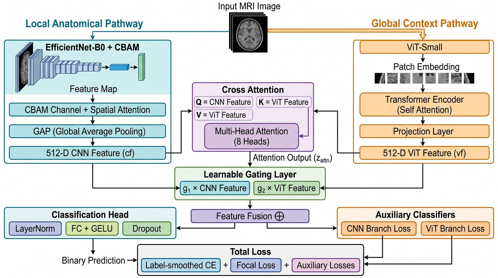
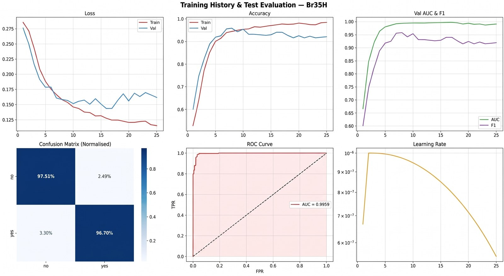
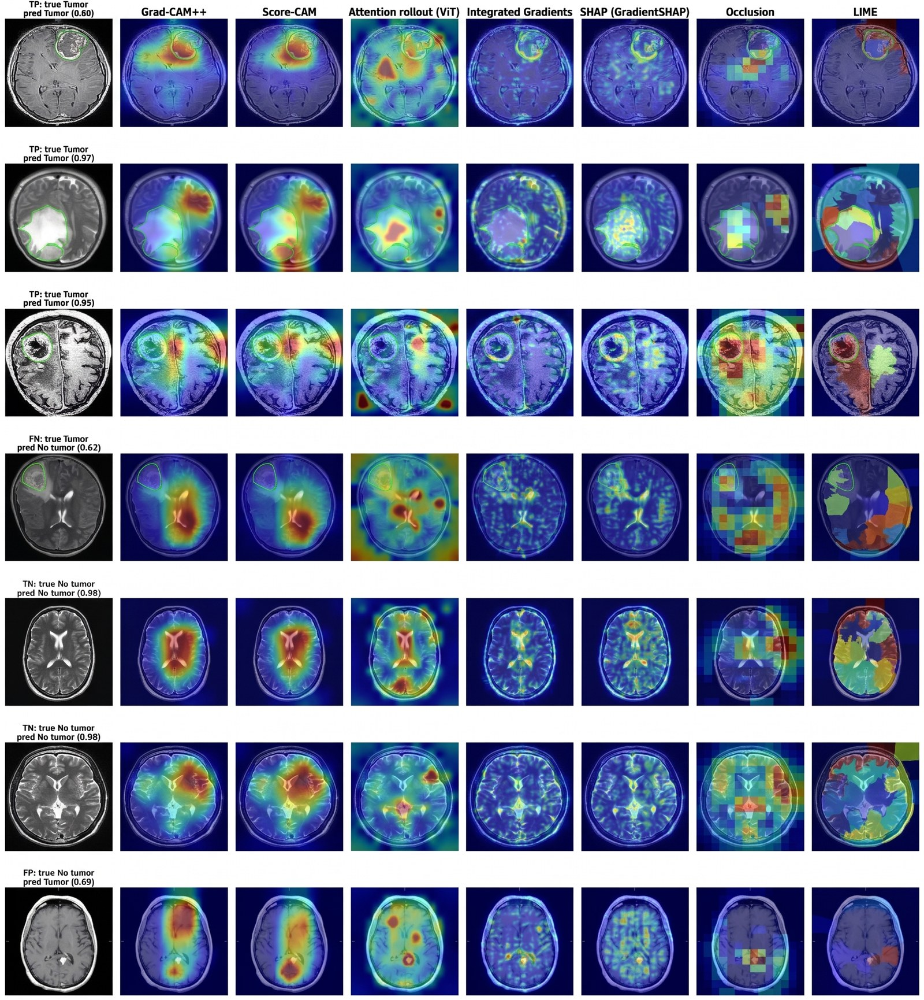
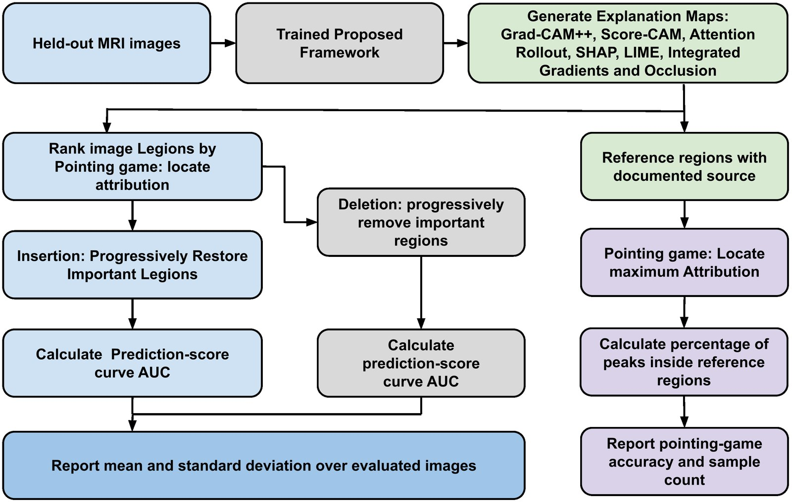

<div align="center">

# VBT-xAI

### Gated Cross-Attention CBAM-EfficientNet and Vision Transformer for Explainable Brain Tumor MRI Classification

[](https://www.python.org/)
[](https://pytorch.org/)
[](https://github.com/huggingface/pytorch-image-models)
[](#9-quantitative-xai-evaluation)
[-F9AB00?logo=googlecolab&logoColor=white)](https://colab.research.google.com/github/YOUR-USERNAME/VBT-xAI_BrainTumor-MRI_Br35H/blob/main/notebooks/VBT-xAI_Br35H_end_to_end.ipynb)
[](LICENSE)

[Overview](#1-overview) •
[Highlights](#2-highlights) •
[Layout](#3-repository-layout) •
[Installation](#4-installation) •
[Data](#5-data) •
[Architecture](#6-model-architecture) •
[Pipeline](#7-pipeline) •
[Results](#8-results) •
[XAI](#9-quantitative-xai-evaluation) •
[Citation](#12-citation)

</div>

---

## 1. Overview

**VBT-xAI** is a hybrid deep-learning framework for binary brain tumor detection (tumor / no tumor) on MRI. It combines two complementary pathways:

- **Local anatomical pathway:** EfficientNet-B0 refined by a Convolutional Block Attention Module (CBAM), capturing fine-grained spatial and textural patterns.
- **Global context pathway:** ViT-Small/16, capturing long-range dependencies across the image.

The two 512-d representations interact through **8-head cross-attention** and are weighted by an input-dependent **learnable gate**. Auxiliary classifiers on each branch provide intermediate supervision.

The evaluation is **leakage-controlled**: exact and near-duplicate images are detected, and copies of the same scan (rescaled, mirrored, recompressed) are grouped into scan clusters that never cross the train / validation / test boundary. The model's decisions are analysed with **seven XAI methods**, scored quantitatively against random baselines and the expert tumor outlines released with Br35H, together with a **shortcut-learning audit**.

> All results come from one public dataset with no patient identifiers. External multi-centre validation and expert clinical evaluation are required before any clinical use.

## 2. Highlights

| Component | Details |
|---|---|
| CNN pathway | EfficientNet-B0 (ImageNet) → CBAM (r = 16, k = 7) → GAP → 512-d projection |
| ViT pathway | ViT-Small-Patch16-224 (ImageNet) → [CLS] → 512-d projection |
| Fusion | 8-head cross-attention (Q = CNN, K = V = ViT) + FFN, plus softmax gate: `z = g1·cf + g2·vf + z_attn` |
| Loss | 0.5 × label-smoothed CE (0.05) + 0.5 × focal loss + 0.3 × mean auxiliary-branch loss, all class-weighted |
| Leakage control | MD5 exact-duplicate removal, pHash (Hamming ≤ 5) near-duplicates, scan-cluster `GroupShuffleSplit` with hard assertions |
| Validation | Independent test set, 5-fold scan-cluster-grouped CV, 8-variant ablation with paired significance tests, TTA |
| XAI | Grad-CAM++, Score-CAM, ViT attention rollout, Integrated Gradients, GradientSHAP, occlusion, LIME |
| XAI evaluation | Insertion / deletion AUC vs. uniform and in-brain random maps, expert-outline pointing game with chance level, Wilcoxon + Holm on scan-cluster means |
| Size | 30.02 M parameters; trained in about 12 min on a single NVIDIA T4 |

## 3. Repository layout

<details>
<summary><b>Click to expand the file tree</b></summary>

```text
VBT-xAI_BrainTumor-MRI_Br35H/
├── notebooks/
│   └── VBT-xAI_Br35H_end_to_end.ipynb   # full pipeline: data → training → evaluation → XAI → report
├── src/
│   ├── model.py                         # CBAM, CNN/ViT branches, cross-attention fusion, HybridModel
│   ├── losses.py                        # SmoothCE, FocalLoss, CombLoss, AdamW groups, warm-up+cosine, EMA
│   ├── br35h_data.py                    # expert tumor masks (VIA), scan clusters, leakage flags, brain mask
│   └── xai_faithfulness_eval.py         # insertion/deletion, pointing game, statistics, Table 8, Figure 8
├── docs/
│   └── figures/                         # figures used in this README
├── results/                             # created at run time (git-ignored)
├── requirements.txt
├── LICENSE
└── README.md
```

</details>

The notebook is self-contained: it writes `br35h_data.py` and `xai_faithfulness_eval.py` to the runtime itself (Cell 4b). The files in `src/` are the same code, provided so the model and evaluation can be read, imported and reused outside the notebook.

## 4. Installation

**Option A: Google Colab (recommended, used for the paper)**

1. Click the **Open in Colab** badge above.
2. *Runtime → Change runtime type → T4 GPU.*
3. Run Cell 1 (mounts Google Drive) and Cell 2 (installs libraries), then *Runtime → Restart session* and continue from Cell 1.

**Option B: local machine**

```bash
git clone https://github.com/YOUR-USERNAME/VBT-xAI_BrainTumor-MRI_Br35H.git
cd VBT-xAI_BrainTumor-MRI_Br35H
python -m venv .venv
source .venv/bin/activate        # Windows: .venv\Scripts\activate
pip install -r requirements.txt
```

Locally, skip the Colab-only cells (`google.colab` imports, Drive mount) and set `Config.DATASET_PATH`, `Config.CHECKPOINT` and `Config.RESULTS` in Cell 5 to local folders.

> [!TIP]
> `LOW_MEMORY_MODE = True` (default) uses EfficientNet-B0 + ViT-Small, the configuration reported in the paper, and fits a free 16 GB T4. Setting it to `False` switches to EfficientNetV2-S + ViT-Base.

## 5. Data

**Br35H :: Brain Tumor Detection 2020** ([Kaggle: `ahmedhamada0/brain-tumor-detection`](https://www.kaggle.com/datasets/ahmedhamada0/brain-tumor-detection)): 3,000 MRI slices in two folders, `yes` (tumor) and `no` (no tumor). The `pred` folder is unlabelled and excluded.

Cell 3 downloads it automatically with the Kaggle API. Provide a token either as Colab Secrets (`KAGGLE_USERNAME`, `KAGGLE_KEY`) or by uploading `kaggle.json` when prompted.

**Expert tumor outlines** (used only for the XAI pointing game) come from the dataset author's repository ([AhmedHamada0/Brain-Tumor-Detection-Dataset](https://github.com/AhmedHamada0/Brain-Tumor-Detection-Dataset), folder `Br35H-Mask-RCNN`): 801 annotated images, matched to the classification set by MD5. Cell 15c fetches them if they are missing.

**Leakage control.** Br35H contains many copies of the same scan. Before splitting, the pipeline:

1. removes exact MD5 duplicates;
2. finds near-duplicates with perceptual hashing (Hamming distance ≤ 5);
3. groups remaining rescaled and mirrored copies into **scan clusters** (MD5, pHash, mirrored pHash, pixel correlation);
4. splits **by cluster** (70 / 15 / 15, `GroupShuffleSplit`, seed 42) and asserts that no cluster appears in more than one split.

> [!WARNING]
> The code is MIT-licensed; the Br35H data is **not** redistributed here. Download it from Kaggle and follow its licence and terms of use.

## 6. Model architecture

<p align="center">
  
</p>

<p align="center"><b>Figure 1.</b> VBT-xAI: local anatomical pathway (EfficientNet-B0 + CBAM), global context pathway (ViT-Small/16), 8-head cross-attention, learnable gating, auxiliary classifiers and the combined loss.</p>

| Setting | Value |
|---|---|
| Input | 224 × 224 RGB, ImageNet normalisation |
| CNN backbone | `efficientnet_b0` (timm, pretrained) + CBAM on the 7 × 7 × 1280 map |
| ViT backbone | `vit_small_patch16_224` (timm, pretrained), 197 tokens, d = 384, 12 layers |
| Fusion dimension | 512 |
| Cross-attention | 8 heads, dropout 0.1, FFN expansion 4, GELU |
| Gate | Linear(1024 → 2) + softmax |
| Head | LayerNorm → Linear(512 → 256) → GELU → Dropout(0.4) → Linear(256 → 2) |
| Optimizer | AdamW, LR 1e-5 (fusion / gate / head), 1e-6 (backbones), weight decay 1e-5 |
| Schedule | 3-epoch linear warm-up, then cosine decay |
| Training | batch 16, max 50 epochs, gradient clipping 1.0, mixed precision, EMA 0.999 |
| Early stopping | patience 8 on validation AUC; best-validation-AUC checkpoint is tested once |
| Augmentation (train only) | flip, shift-scale-rotate, CLAHE / brightness-contrast / gamma, Gaussian noise, coarse dropout |

Load a trained checkpoint outside the notebook:

```python
import sys, torch
sys.path.insert(0, "src")
from model import HybridModel, ModelWrapper

model = HybridModel(pretrained=False)
ckpt = torch.load("best_model.pth", map_location="cpu", weights_only=False)
model.load_state_dict(ckpt["state"])
model.eval()
logits = ModelWrapper(model)(torch.randn(1, 3, 224, 224))
```

## 7. Pipeline

Run the notebook top to bottom after a fresh runtime restart. Only results produced this way should be reported.

| Step | Notebook cell | What it does |
|---|---|---|
| 0 | Cells 1–2 | Mount Drive, check GPU, install libraries |
| 1 | Cell 3 | Download Br35H from Kaggle |
| 2 | Cells 4, 4b | Imports; write the data-audit and XAI-evaluation modules |
| 3 | Cell 5 | Configuration (`Config`) |
| 4 | Cell 6 | Explore, de-duplicate, build scan clusters, split, augment, DataLoaders |
| 5 | Cells 7–9 | Build the model, loss, optimizer, scheduler, EMA; train with early stopping |
| 6 | Cell 10 | Test-set evaluation, training curves, confusion matrix, ROC |
| 7 | Cells 11–13 | Qualitative XAI: Grad-CAM++ / Score-CAM, LIME, SHAP, occlusion, side-by-side panel |
| 8 | Cell 14 | 5-fold scan-cluster-grouped cross-validation *(heavy)* |
| 9 | Cell 15 | 8-variant ablation study, t-SNE / UMAP *(heavy)* |
| 10 | Cell 15b | Shortcut-learning audit (brain-only, background-only, skull-masked inputs) |
| 11 | Cell 15c | Final quantitative XAI evaluation → Table 8, Figure 8 |
| 12 | Cell 16 | Test-time augmentation, bootstrap CIs, final report, ONNX export |
| 13 | Cell 15d | Per-variant significance tests for the ablation table |

<details>
<summary><b>Key configuration flags (Cell 5)</b></summary>

| Flag | Default | Meaning |
|---|---|---|
| `LOW_MEMORY_MODE` | `True` | EfficientNet-B0 + ViT-Small (paper setting) |
| `RUN_HEAVY_CELLS` | `True` | Run K-fold CV and the ablation study (several hours on a T4). Set `False` for a quick end-to-end check |
| `SCAN_GROUP_SPLIT` | `True` | Split by scan cluster. `False` groups by file name, which lets copies of the same scan leak into the test set |
| `XAI_MAX_IMAGES` | `None` | Whole test set for Cell 15c (about 1 h on a T4); an integer runs a seeded subset |
| `XAI_RUN_BLACK_SENSITIVITY` | `False` | Repeat insertion / deletion with a black baseline instead of blur |
| `SEED` | `42` | Global seed |

</details>

## 8. Results

All numbers are from the independent, scan-cluster-disjoint test set (474 images from 95 scan clusters).

**Classification performance**

| Metric | Value |
|---|---|
| Accuracy | **97.05%** |
| AUC-ROC (95% CI) | **0.9959** (0.9920–0.9988) |
| Weighted F1-score | 0.9705 |
| Weighted precision / recall | 0.9707 / 0.9705 |
| Balanced accuracy | 0.9711 |
| Matthews correlation coefficient | 0.9398 |
| Cohen's κ | 0.9397 |

**5-fold cross-validation** (train + validation data only, scan-cluster-grouped): accuracy 0.9797 ± 0.0093, AUC 0.9986 ± 0.0016, F1 0.9797 ± 0.0093, MCC 0.9596 ± 0.0186.

<details>
<summary><b>Ablation study</b> (same split, epoch budget, warm-up, early stopping and checkpoint rule for every variant)</summary>

| Variant | AUC | Accuracy (%) | F1 |
|---|---|---|---|
| CNN baseline (EfficientNet-B0) | 0.9836 | 96.84 | 0.9683 |
| CNN + CBAM | 0.9855 | 96.41 | 0.9641 |
| ViT baseline (ViT-S/16) | 0.9904 | 97.05 | 0.9704 |
| CNN + ViT (concatenation) | 0.9921 | 95.36 | 0.9534 |
| CNN + ViT + cross-attention | 0.9912 | 97.47 | 0.9746 |
| CNN + ViT + gating | 0.9920 | 97.26 | 0.9725 |
| CNN + ViT + cross-attention + gating (no CBAM) | 0.9883 | 97.68 | 0.9767 |
| **VBT-xAI (full)** | **0.9959** | 97.05 | 0.9705 |

The full model has the highest AUC. Accuracy differences between the best variants are three test images or fewer, and all 95% intervals overlap, so the ablation does not isolate an independent effect for each component.

</details>

**Shortcut-learning audit** (200 random test images)

| Input | Accuracy | AUC |
|---|---|---|
| Original MRI | 0.9650 | 0.9982 |
| Brain region only | 0.9000 | 0.9901 |
| Skull-masked | 0.8850 | 0.9693 |
| Background only | 0.6150 | 0.6544 |

Predictions rely mainly on anatomical content; the above-chance background-only AUC indicates a weak contribution from non-anatomical cues.

<p align="center">
  
</p>
<p align="center"><b>Figure 2.</b> Loss and accuracy curves, normalised confusion matrix, ROC curve and learning-rate schedule.</p>

## 9. Quantitative XAI evaluation

Explanations are scored on 143 tumor test images with expert outlines (insertion / deletion: 50 steps, Gaussian-blur baseline; pointing game: 15-px tolerance; chance 23.8%).

| Method | Insertion ↑ | Deletion ↓ | Pointing game hit (%) |
|---|---|---|---|
| Grad-CAM++ | 0.913 | 0.858 | 36.4 |
| Score-CAM | 0.919 | 0.848 | 56.6 |
| Attention rollout | 0.918 | 0.798 | 68.5 |
| Integrated Gradients | 0.965 | 0.393 | 30.8 |
| GradientSHAP | 0.944 | 0.604 | **76.9** |
| Occlusion | 0.949 | 0.757 | 53.8 |
| LIME | 0.956 | 0.656 | 55.2 |
| Random (uniform) | 0.857 | 0.857 | 12.1 |
| Random (in-brain) | 0.874 | 0.845 | 21.9 |

<p align="center">
  
</p>
<p align="center"><b>Figure 5.</b> True positives, a false negative, true negatives and a false positive (rows) explained by seven methods (columns). Green contours mark expert tumor outlines.</p>

<details>
<summary><b>XAI evaluation workflow</b></summary>
<p align="center"></p>
</details>

The attribution maps show association, not causation, and are not a clinical validation.

## 10. Outputs

Paths are set in Cell 5 (`Config.CHECKPOINT`, `Config.RESULTS`; Google Drive by default).

```text
brain_tumor_results/
├── checkpoints/
│   └── best_model.pth                  # {'epoch', 'state', 'auc'}
└── results/
    ├── *.png                           # training curves, CAM / LIME / SHAP / occlusion panels, t-SNE, UMAP
    ├── xai_final_blur/
    │   ├── table8.md                   # Table 8
    │   ├── provenance.json             # checkpoint epoch, image count, timestamp
    │   └── ...                         # per-image scores and summary
    ├── figure8_xai_final.png
    ├── ablation_results_export.csv
    ├── model_comparison_export.csv
    └── hybrid_model.onnx               # optional
```

## 11. Notes and limitations

- Single public dataset; Br35H has no patient identifiers, so scan clusters are the closest available proxy for subjects.
- Confidence intervals treat test images as independent; with 95 scan clusters they are somewhat optimistic.
- Ablation variants were trained once each; separating component effects would need multiple seeds.
- `cudnn.benchmark = True` makes re-runs slightly non-deterministic.
- Explanations are not causal and have not been reviewed by radiologists.

## 12. Citation

If you use this code, please cite:

```bibtex
@article{afzal2026vbtxai,
  title   = {Framework of {CBAM}-{EfficientNet} and Vision Transformer Representations
             for Explainable Brain Tumor {MRI} Classification},
  author  = {Afzal, Zeshan and Nauman, Muhammad and Aslam, Saba and
             Sid'El Moctar, Sidi Mohamed and Rasool, Abdur and Bunterngchit, Chayut},
  journal = {Under review},
  year    = {2026}
}

@misc{hamada2020br35h,
  title  = {Br35H :: Brain Tumor Detection 2020},
  author = {Hamada, Ahmed},
  year   = {2020},
  howpublished = {\url{https://www.kaggle.com/datasets/ahmedhamada0/brain-tumor-detection}}
}
```

## 13. Acknowledgements

[Br35H](https://www.kaggle.com/datasets/ahmedhamada0/brain-tumor-detection) and its expert annotations, [timm](https://github.com/huggingface/pytorch-image-models), [pytorch-grad-cam](https://github.com/jacobgil/pytorch-grad-cam), [Captum](https://captum.ai/), [SHAP](https://github.com/shap/shap), [LIME](https://github.com/marcotcr/lime) and [PyTorch](https://pytorch.org/).

**Contact:** Zeshan Afzal (shanansari@gmail.com)

## 14. License

Released under the [MIT License](LICENSE).
